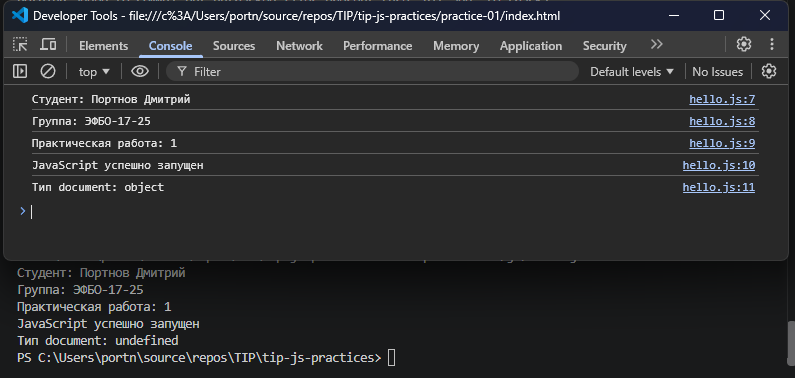

# Практическая работа № 1. Подготовка окружения и первые программы на JavaScript

## Автор

- Студент: Портнов Дмитрий Романович
- Группа: ЭФБО-17-25
- Вариант: 4 (`totalTasks = 20`, `completedTasks = 11`, `dailyLimit = 6`)

## Окружение

| Компонент | Версия |
| :--- | :--- |
| ОС | Windows 11 Pro |
| Node.js | v24.21.0 |
| npm | 11.19.0 |
| Git | git version 2.45.1.windows.1 |
| Браузер | Встроенный браузер Visual Studio Code (DevTools) |

Команды проверки версий:

```bash
node --version
npm --version      # в PowerShell: npm.cmd --version
git --version
```

## Запуск

Запуск в Node.js из корня репозитория:

```bash
node practice-01/js/hello.js
node practice-01/js/types.js
node practice-01/js/progress.js
node practice-01/js/plan.js
node practice-01/js/debug.js
```

Запуск в браузере:

1. В `practice-01/index.html` подключить нужный учебный файл (одновременно подключается только один скрипт):
   `<script src="./js/hello.js" defer></script>`.
2. Открыть `practice-01/index.html` как локальный файл.
3. Открыть DevTools (F12) и вкладку **Console**: результат выводится в консоль, а не на страницу.
4. После изменения файла сохранить его и перезагрузить страницу.

## Задание 1. hello.js: различие сред

| Среда | Вывод `typeof document` |
| :--- | :--- |
| Node.js | `undefined` |
| Браузер (Console) | `object` |

Объект `document` — это часть DOM API, которое предоставляет браузер для работы с загруженной страницей.
Node.js — среда выполнения JavaScript вне браузера: страницы и DOM в ней нет, поэтому глобальной переменной `document`
не существует и `typeof document` возвращает `"undefined"` (без ошибки, так как `typeof` безопасен для необъявленных имён).
Сам язык одинаков, различаются объекты, которые предоставляет среда.



## Задание 2. types.js: типы и преобразования

| № | Выражение | Ожидание до запуска | Фактическое значение | Тип результата | Объяснение |
| :--- | :--- | :--- | :--- | :--- | :--- |
| 1 | `"8" + 2` | `"10"` (или `10`) | `"82"` | `string` | Оператор `+` со строкой выполняет конкатенацию. Число 2 неявно приводится к строке `"2"`. |
| 2 | `"8" - 2` | `6` | `6` | `number` | Оператор `-` работает только с числами. Строка `"8"` неявно приводится к числу 8. |
| 3 | `Number("8") + 2` | `10` | `10` | `number` | `Number()` явно преобразует строку `"8"` в число 8, далее обычное сложение чисел. |
| 4 | `"12" > "3"` | `true` | `false` | `boolean` | Две строки сравниваются посимвольно (лексикографически): `"1"` меньше `"3"`, поэтому `"12"` меньше `"3"`. |
| 5 | `12 === "12"` | `true` | `false` | `boolean` | Строгое равенство сравнивает и значение, и тип; `number` не равен `string`. |
| 6 | `Number("")` | `NaN` (или ошибка) | `0` | `number` | Пустая строка при приведении к числу даёт `0`. |
| 7 | `Number("text")` | `NaN` | `NaN` | `number` | Текст нельзя преобразовать в число; `NaN` технически имеет тип `number`. |
| 8 | `Boolean("false")` | `false` | `true` | `boolean` | Любая непустая строка (даже `"false"`) приводится к `true`. |
| 9 | `typeof null` | `"null"` | `"object"` | `string` | Историческая особенность JS. `typeof` всегда возвращает строку. |
| 10 | `typeof NaN` | `"NaN"` | `"number"` | `string` | `NaN` относится к числовому типу; `typeof` возвращает строку `"number"`. |

## Задание 3. progress.js: прогресс выполнения

Порядок обработки: сначала проверки входных данных (тип, `NaN`, целочисленность, отрицательные значения,
верхняя граница 1000, `completedTasks ≤ totalTasks`), затем нулевой случай, затем обычный расчёт.
Статус определяется по исходным числам, а не по округлённому проценту.

| Вход (`totalTasks`, `completedTasks`) | Ожидание | Факт | Итог |
| :--- | :--- | :--- | :--- |
| **20, 11 (вариант 4)** | осталось 9, 55.0%, «В работе» | Всего 20, выполнено 11, осталось 9, прогресс 55.0%, статус «В работе» | ✅ |
| 12, 5 | осталось 7, 41.7%, «В работе» | Всего 12, выполнено 5, осталось 7, прогресс 41.7%, статус «В работе» | ✅ |
| 0, 0 | «Задач пока нет», процент не считается | «Задач пока нет. Процент в этом случае не рассчитывается.» | ✅ |
| 5, 0 | осталось 5, 0.0%, «Не начато» | Всего 5, выполнено 0, осталось 5, прогресс 0.0%, статус «Не начато» | ✅ |
| 5, 5 | осталось 0, 100.0%, «Завершено» | Всего 5, выполнено 5, осталось 0, прогресс 100.0%, статус «Завершено» | ✅ |
| 5, 6 | Ошибка | «Ошибка: выполнено больше, чем существует.» | ✅ |
| -1, 0 | Ошибка | «Ошибка: отрицательное количество.» | ✅ |
| 5, 2.5 | Ошибка | «Ошибка: дробное количество.» | ✅ |
| "5", 2 | Ошибка | «Ошибка: вместо числа передана строка.» | ✅ |
| 1001, 0 | Ошибка | «Ошибка: превышена верхняя граница.» | ✅ |
| NaN, 0 | Ошибка | «Ошибка: недопустимое числовое значение.» | ✅ |

## Задание 4. plan.js: план по дням

`totalTasks` и `completedTasks` проверяются по правилам задания 3, `dailyLimit` — целое число от 1 до 1000.
При ошибке выводится одно сообщение `Ошибка: ...` и цикл не запускается. Расчёт выполняется циклом `while`:
на каждой итерации номер дня увеличивается, за день выполняется `Math.min(dailyLimit, remaining)` задач, остаток уменьшается.
Последняя итерация отличается тем, что остаток может быть меньше дневной нормы.

| Вход (`total`, `completed`, `dailyLimit`) | Ожидание | Факт | Итог |
| :--- | :--- | :--- | :--- |
| **20, 11, 6 (вариант 4)** | осталось 9; дни: 3, 0; 2 дня | Осталось 9. День 1: выполнено 6, осталось 3. День 2: выполнено 3, осталось 0. Потребуется дней: 2 | ✅ |
| 12, 5, 3 | осталось 7; дни: 4, 1, 0; 3 дня | Осталось 7. День 1: 3 → 4; день 2: 3 → 1; день 3: 1 → 0. Потребуется дней: 3 | ✅ |
| 10, 4, 3 | осталось 6; дни: 3, 0; 2 дня | Осталось 6. День 1: 3 → 3; день 2: 3 → 0. Потребуется дней: 2 | ✅ |
| 5, 3, 10 | осталось 2; 1 день | Осталось 2. День 1: выполнено 2, осталось 0. Потребуется дней: 1 | ✅ |
| 5, 5, 2 | задач не осталось, 0 дней | «Все задачи уже выполнены.» «Потребуется дней: 0» | ✅ |
| 0, 0, 2 | задач нет, 0 дней | «Задач нет.» «Потребуется дней: 0» | ✅ |
| 5, 2, 0 | Ошибка | «Ошибка: дневная норма должна быть от 1 до 1000.» | ✅ |
| 5, 2, 1.5 | Ошибка | «Ошибка: дробное количество.» | ✅ |
| 5, 6, 2 | Ошибка | «Ошибка: некорректное число выполненных задач.» | ✅ |
| 5, 2, "2" | Ошибка | «Ошибка: вместо числа передана строка.» | ✅ |
| 5, 2, 1001 | Ошибка | «Ошибка: дневная норма должна быть от 1 до 1000.» | ✅ |

Без проверки `dailyLimit` значение `0` привело бы к бесконечному циклу: остаток не уменьшался бы.

## Задание 5. debug.js: отладка

Ожидаемый результат: «Выполнено: 5», «Осталось: 3», «Контрольная сумма: 10».

Исходный вывод (до исправления):

```text
Выполнено: 32
Осталось: -24
Контрольная сумма: 6
```

Исправленный вывод (Node.js и браузер):

```text
Выполнено: 5
Осталось: 3
Контрольная сумма: 10
```

| Ошибка | Наблюдение | Причина | Исправление | Результат |
| :--- | :--- | :--- | :--- | :--- |
| Сложение строк | На breakpoint `completedTotal = "32"`, тип `string` | `"3" + "2"` — оператор `+` со строками выполняет конкатенацию | Явное преобразование: `Number(completedText) + Number(additionalText)` | `completedTotal = 5` (`number`) |
| Вычитание из строки | `remainingTasks = -24` | `"8" - "32"`: строки неявно приводятся к числам, но второе значение уже ошибочное `32` | После исправления сложения: `Number(plannedText) - completedTotal` | `remainingTasks = 3` |
| Граница цикла | В цикле `taskNumber` принимает 1, 2, 3; `controlSum` = 1, 3, 6 | Условие `taskNumber < 4` исключает четвёртую задачу | Условие `taskNumber <= 4` | `controlSum = 10` |

Порядок отладки: `debug.js` подключён в `index.html`, в DevTools → Sources поставлен breakpoint на строке вычисления
`completedTotal`, после перезагрузки значения и типы изучены во вкладке Scope, выполнен Step over;
затем breakpoint поставлен внутри цикла для отслеживания `taskNumber` и `controlSum`.
После исправления breakpoints удалены, а в `index.html` возвращён `hello.js`.


## Вывод

В работе подготовлено окружение (Node.js, npm, Git) и репозиторий с нужной структурой. Написаны программы, которые
запускаются в Node.js и в браузере; на `typeof document` показано различие сред выполнения. На практике изучены
неявные преобразования типов: конкатенация строк через `+`, лексикографическое сравнение строк, `Number("")`,
`typeof null`. В заданиях 3 и 4 реализована проверка входных данных без преобразования строк, обработка нулевого случая
и цикл `while` с ограничением по дневной норме; все обязательные проверки и данные варианта 4 дают ожидаемый результат.
С помощью breakpoint в DevTools найдены и исправлены ошибки преобразования типов и границы цикла в `debug.js`.
