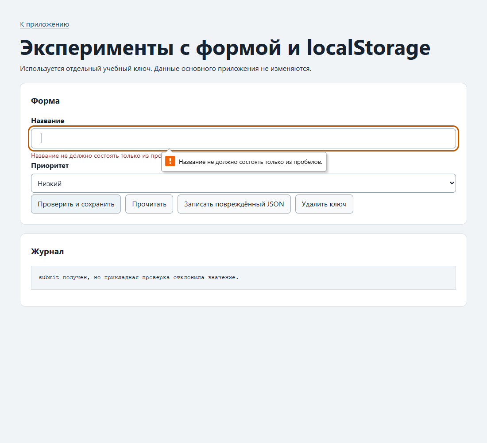
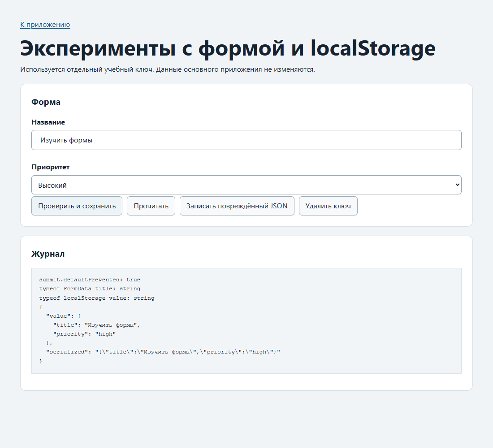
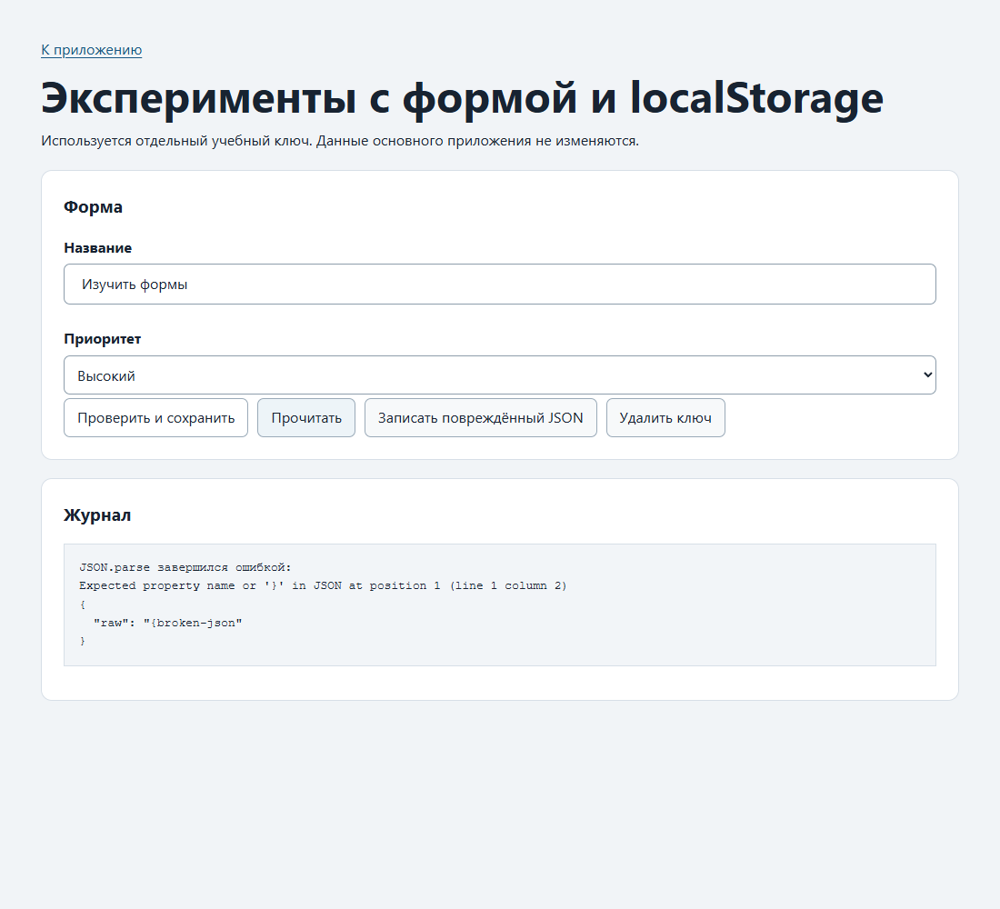
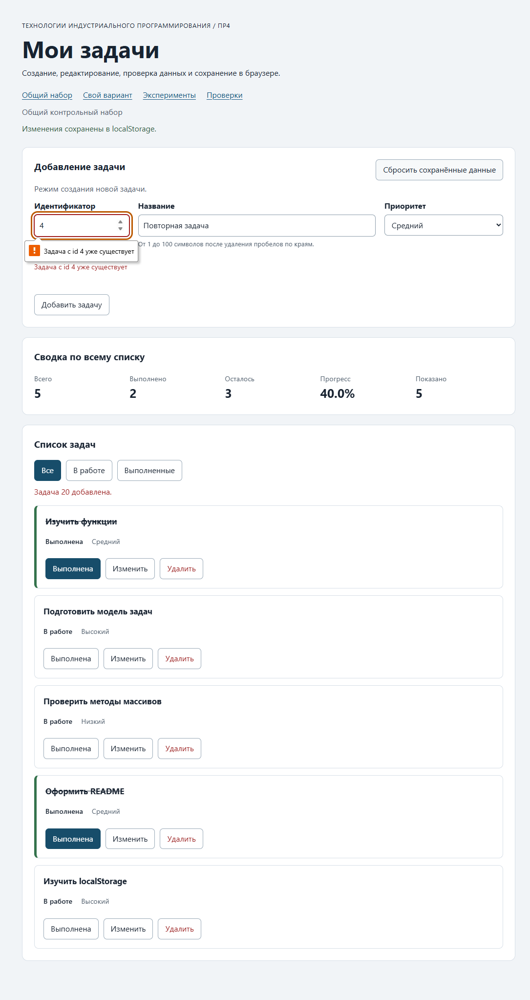
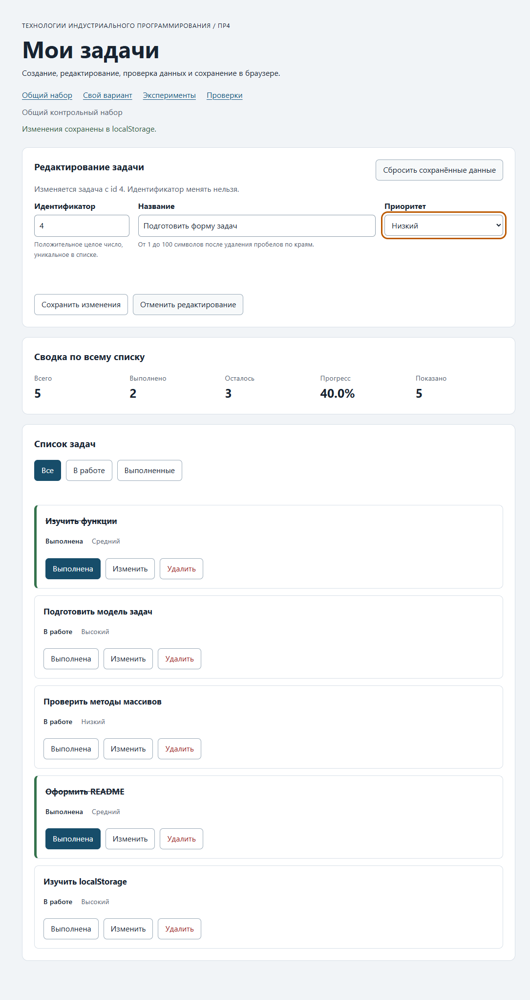
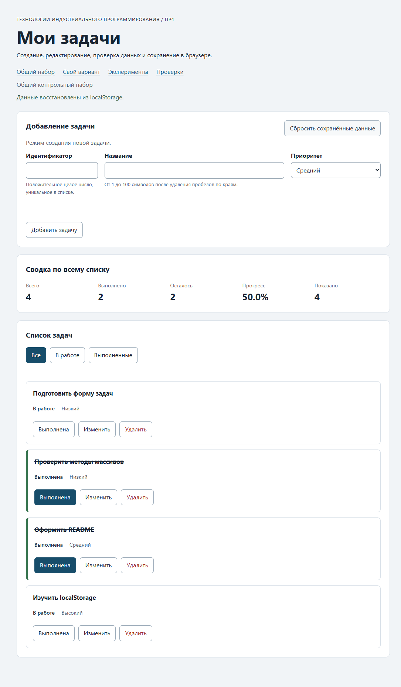
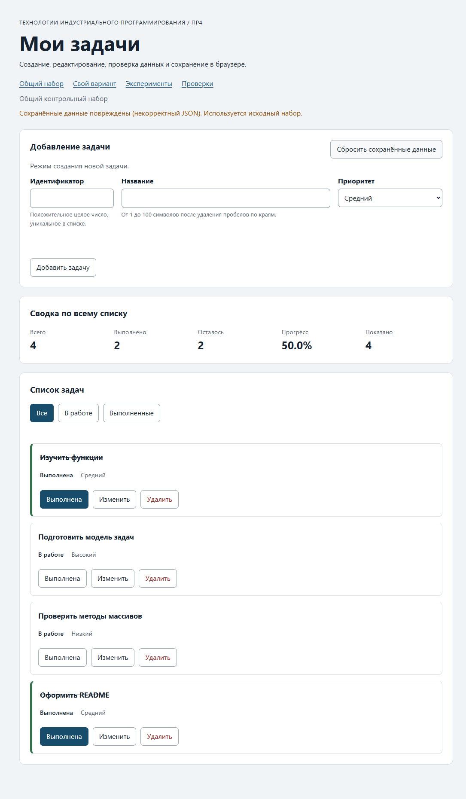
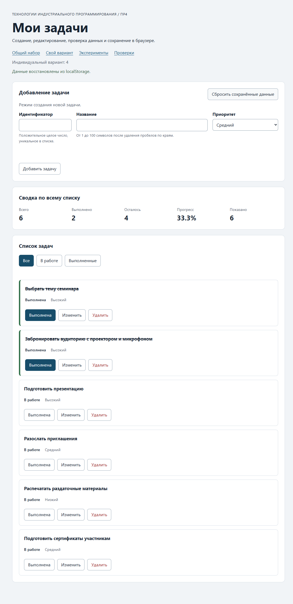
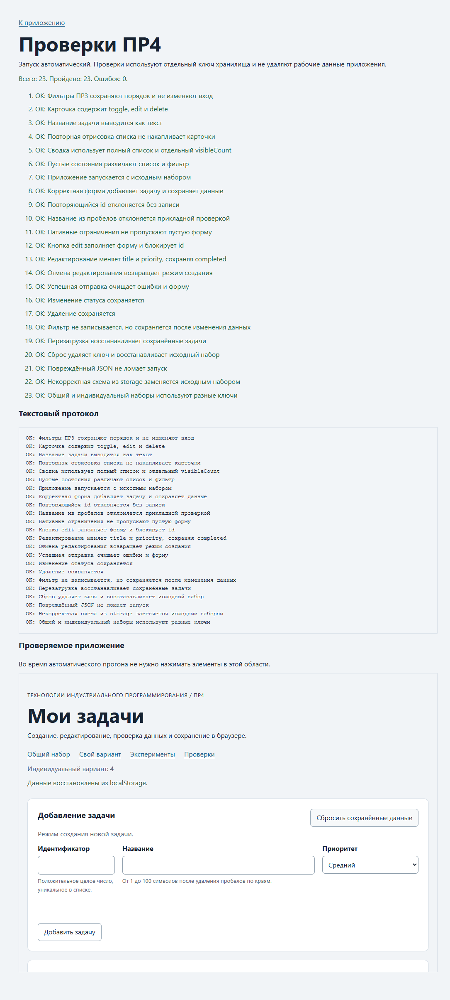
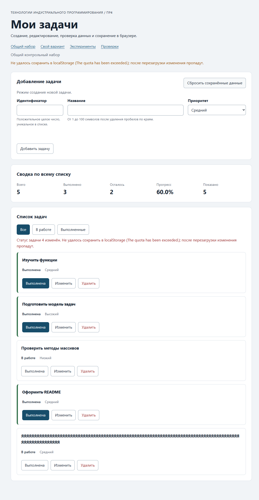

# Практическая работа № 4. Формы, валидация и локальное хранение данных

Выполнил Портнов Дмитрий Романович, группа ЭФБО-17-25, вариант 4 (подготовка семинара — тот же набор, что в ПР2–ПР3).

Окружение: Windows 11 Pro, Node.js v24.21.0, npm 11.19.0, Google Chrome 157.0.8103.38.

## Как запустить

Из папки `practice-04`:

```bash
npm test    # проверки сервиса (35) и новых модулей (27)
npm start   # сервер на http://127.0.0.1:5504/
```

В PowerShell у меня `npm` заблокирован политикой, поэтому пишу `npm.cmd test` и `npm.cmd start`. Ставить пакеты не нужно.

- http://127.0.0.1:5504/ — общий набор;
- http://127.0.0.1:5504/index.html?dataset=variant — мой вариант;
- http://127.0.0.1:5504/examples/forms-storage.html — эксперименты;
- http://127.0.0.1:5504/checks.html — браузерные проверки.

Важно открывать всегда один и тот же адрес: `localStorage` привязан к origin, и на `localhost:5504` или другом порту сохранённых данных просто не будет.

## Что перенёс из ПР3

| Файл | Что сделал |
|---|---|
| `data.js` | Скопировал без изменений: общий набор и шесть задач варианта 4. |
| `task-service.js` | Скопировал и добавил `updateTask`. Внутренний помощник, который тоже назывался `updateTask`, переименовал в `replaceTask`, иначе имена бы столкнулись. |
| `task-selectors.js` | Скопировал без изменений. |
| `task-view.js` | Скопировал и добавил в карточку третью кнопку «Изменить» (`data-action="edit"`) между «Выполнена» и «Удалить». |

Сразу после переноса `npm run check:service` показал 35 из 35.

## Эксперименты с формой и хранилищем

| № | Что ожидал | Что получилось | Почему так |
|---:|---|---|---|
| 1. Пустое название | думал, обработчик что-то напишет в журнал | Журнал не изменился («Действия ещё не выполнялись.»). У поля `validity.valid = false`, `valueMissing = true`, браузер показал подсказку «Please fill out this field.» | `required` проверяет браузер ещё **до** события `submit`. Раз форма невалидна, `submit` вообще не возникает, и наш код не вызывается. |
| 2. Только пробелы | думал, `required` не пропустит | Пропустил: в журнале «submit получен, но прикладная проверка отклонила значение.» Под полем — «Название не должно состоять только из пробелов.», `customError = true`. Повторная отправка без исправления снова блокируется. После ввода текста `valid` опять `true` | Для `required` строка из пробелов непустая. Отсекает её уже наш `trim`, а `setCustomValidity` делает поле невалидным, пока пользователь не начнёт печатать (на `input` вызывается `setCustomValidity("")`). |
| 3. Корректные значения `"  Изучить формы  "`, «Высокий» | ожидал строку и обрезанное название | `defaultPrevented: true`, `typeof FormData title: string`, сохранено `{"title":"Изучить формы","priority":"high"}` | `FormData.get` всегда отдаёт строки. `preventDefault` отменил перезагрузку страницы, но обработчик выполнился до конца. |
| 4. Прочитать | думал, вернётся объект | `typeof getItem` — `string`; `raw` — строка JSON, после `JSON.parse` — объект | `localStorage` хранит только строки, объект нужно сериализовать и разбирать самому. |
| 5. Повреждённый JSON | ожидал ошибку | «JSON.parse завершился ошибкой: Expected property name or '}' in JSON at position 1», страница продолжила работать | `JSON.parse` бросает исключение. Без `try/catch` оно оборвало бы обработчик, а в приложении — весь запуск. |





Главное, что я отсюда вынес: проверок три, и они разные. HTML проверяет форму поля, моя валидация — правила модели, а проверка после `JSON.parse` защищает от того, что в хранилище лежит что угодно.

## Как устроен код

- `task-service.js` — чистые операции над массивом задач, в том числе новая `updateTask(tasks, id, title, priority)`. Она меняет только `title` и `priority`, а `completed` сохраняет. Ни DOM, ни хранилища.
- `form-validation.js` — `validateTaskDraft(draft, tasks, editingId)`. Принимает сырые строки из формы и возвращает либо `{ ok: true, value }` с числовым `id` и обрезанным названием, либо `{ ok: false, errors }` со всеми ошибками сразу, по полям. При создании проверяет, что `id` свободен; при редактировании берёт `id` из `editingId`. Пустую строку в `id` отклоняю отдельно: `Number("")` дал бы `0`.
- `task-storage.js` — всё про `localStorage`: `isValidTaskList`, `loadTasks`, `saveTasks`, `removeSavedTasks`. Каждый вызов `getItem`, `setItem` и `removeItem` обёрнут в `try/catch`. Объект хранилища передаётся аргументом. Поэтому проверки подсовывают туда простую имитацию на `Map`, и сразу видно, что модуль зависит от внешнего хранилища.
- `task-view.js` — отрисовка, как в ПР3, плюс кнопка «Изменить».
- `main.js` — состояние (`currentTasks`, `currentFilter`, `editingId`) и обработчики. Он только связывает модули: собирает черновик из `FormData`, отдаёт его в валидацию, вызывает сервис и после успеха сохраняет и перерисовывает.

Данные из JSON я проверяю целиком перед использованием. Успешный `JSON.parse` говорит лишь о том, что синтаксис правильный. Внутри может быть другая версия, повторяющиеся `id` или `completed: "нет"`. Если хотя бы одна задача неправильная, отклоняется весь список, и приложение берёт копию исходного набора и показывает предупреждение. Саму испорченную запись не трогаю: её можно посмотреть в DevTools и удалить кнопкой сброса.

`renderApp` в хранилище не лезет. Сохраняют только успешные add, update, toggle и delete, а выбор фильтра и режим формы не сохраняются.

## Проверка формы

| Сценарий | Ожидал | Получилось | |
|---|---|---|---|
| Добавить 20 «Изучить localStorage», высокий (Enter в поле названия) | Задача в конце, форма очищена, данные сохранены | 5 задач, «Задача 20 добавлена.», поля пустые, фокус в поле id, в storage 5 задач | ✅ |
| Повторный id 4 | Ошибка у поля id, список и storage не меняются | «Задача с id 4 уже существует» под полем, рамка поля подсвечена, `aria-invalid="true"`; storage тот же | ✅ |
| Исправил id после ошибки | Ошибка у id пропадает, остальные не трогаются | После ввода в поле id сообщение и `aria-invalid` исчезли | ✅ |
| Пустая форма | Браузер не даёт отправить | `validity.valid = false`, список не изменился (браузерная проверка) | ✅ |
| Название из пробелов | Отказ прикладной проверки | Ошибка у названия, список прежний (браузерная проверка) | ✅ |
| id `1.5` | Нативный `step="1"` не пропустит | `stepMismatch = true`, ничего не добавилось, storage пуст | ✅ |
| Название 100 символов | Успех | Задача 30 с названием длиной 100 добавлена | ✅ |
| Название 101+ символов | Отказ | Через форму не ввести: вставил 105 символов, `maxlength` оставил 100. Функция `validateTaskDraft` для 101 символа возвращает ошибку (проверка модулей 09) | ✅ |
| Редактирование id 4 | Меняются только название и приоритет, статус прежний | «Подготовить форму задач», «Низкий», статус «В работе» (`completed: false`) и в карточке, и в storage | ✅ |
| Отмена редактирования | Пустая форма создания | Заголовок «Добавление задачи», id снова доступен, кнопка «Добавить задачу», «Отменить» скрыта, фокус в поле id | ✅ |




## Общий сценарий

Начинал с кнопки «Сбросить сохранённые данные» на основном адресе.

| Шаг | Действие | Видимые id | Всего | Выполнено | Осталось | Прогресс | Что в storage |
|---:|---|---|---:|---:|---:|---:|---|
| 0 | После сброса | `[1, 4, 7, 10]` | 4 | 2 | 2 | 50.0% | ключа нет (`null`) |
| 1 | Добавил 20 | `[1, 4, 7, 10, 20]` | 5 | 2 | 3 | 40.0% | 5 задач |
| 2 | Повторный id 4 | без изменений | 5 | 2 | 3 | 40.0% | та же строка, новой записи нет |
| 3 | Изменил id 4 | те же | 5 | 2 | 3 | 40.0% | `{"id":4,"title":"Подготовить форму задач","completed":false,"priority":"low"}` |
| 4 | Выполнил id 7 | те же | 5 | 3 | 2 | 60.0% | обновлено |
| 5 | Удалил id 1 | `[4, 7, 10, 20]` | 4 | 2 | 2 | 50.0% | 4 задачи |
| 6 | Перезагрузил | `[4, 7, 10, 20]` | 4 | 2 | 2 | 50.0% | «Данные восстановлены из localStorage.» |
| 7 | Сбросил | `[1, 4, 7, 10]` | 4 | 2 | 2 | 50.0% | ключа снова нет |

Всё совпало с методичкой. После перезагрузки форма открылась в режиме создания: режим редактирования не сохраняется, так и задумано.



Потом записал в `tip-js-practice-04:demo` строку `{broken-json` и обновил страницу. Приложение запустилось с исходными задачами `[1, 4, 7, 10]` и оранжевым предупреждением «Сохранённые данные повреждены (некорректный JSON). Используется исходный набор.». Испорченная строка осталась в хранилище. После сброса ключ удалился.



## Восстановление и ошибки хранилища

| Случай | Ожидал | Получилось | |
|---|---|---|---|
| Записи нет | Исходный набор, без предупреждения | «Используется исходный набор; сохранённых данных пока нет.» | ✅ |
| Корректная запись | Восстановление после перезагрузки | Шаг 6 и вариант — данные на месте, «Данные восстановлены из localStorage.» | ✅ |
| Повреждённый JSON | Исходный набор + предупреждение | См. выше | ✅ |
| `version: 2` | Исходный набор + предупреждение | «Сохранённые данные другой версии или формата. Используется исходный набор.» | ✅ |
| Два задания с одинаковым id | Исходный набор + предупреждение | «Сохранённые задачи не прошли проверку. Используется исходный набор.» | ✅ |
| Сброс | Удаляется только ключ текущего набора | После сброса общего набора `demo = null`, после сброса варианта `variant = null`. В коде только `removeItem(storageKey)`, `clear()` не используется. После прогона `checks.html`, который сбрасывает свои ключи, рабочие ключи не пострадали | ✅ |
| Разделение наборов | Изменения не смешиваются | После правок варианта общий набор открылся исходным, с ключом `demo = null`. Вариант при этом остался изменённым | ✅ |

## Индивидуальный вариант

Исходные задачи — те же шесть, что в ПР2 и ПР3: 11, 23, 37 выполнены, 41, 58, 64 в работе. Перед сценарием нажал «Сбросить» на `?dataset=variant`.

| Этап | Всего | Выполнено | Осталось | Прогресс | Видимые id |
|---|---:|---:|---:|---:|---|
| Исходный набор | 6 | 3 | 3 | 50.0% | `[11, 23, 37, 41, 58, 64]` |
| Добавил 75 «Подготовить сертификаты участникам», средний | 7 | 3 | 4 | 42.9% | `[11, 23, 37, 41, 58, 64, 75]` |
| Изменил 23 → «Забронировать аудиторию с проектором и микрофоном», высокий | 7 | 3 | 4 | 42.9% | те же |
| Удалил 37 | 6 | 2 | 4 | 33.3% | `[11, 23, 41, 58, 64, 75]` |
| Перезагрузил | 6 | 2 | 4 | 33.3% | `[11, 23, 41, 58, 64, 75]` |
| Сбросил | 6 | 3 | 3 | 50.0% | `[11, 23, 37, 41, 58, 64]` |

Итог 33.3% совпадает с таблицей методички для варианта 4. У задачи 23 после редактирования статус остался «Выполнена». Общий набор в это время не изменился.



## Протокол проверок сервиса и модулей

`npm test`:

```text
OK: 01. Создание задачи с явным приоритетом
OK: 02. Приоритет по умолчанию
OK: 03. Удаление краевых пробелов без изменения внутренних
OK: 04. Граничные длины названия и положительный безопасный id
OK: 05. Некорректные названия при создании
OK: 06. Некорректные идентификаторы при создании
OK: 07. Все допустимые приоритеты и отклонение недопустимых
OK: 08. Каждый вызов createTask возвращает новый объект
OK: 09. Поиск по id, а не по индексу
OK: 10. Отсутствующая задача и пустой массив при поиске
OK: 11. Поиск не преобразует строковый id в число
OK: 12. Получение невыполненных задач
OK: 13. Пустой список, все выполнены и все не выполнены
OK: 14. Названия в исходном порядке и пустой список
OK: 15. Сводка по общему набору
OK: 16. Сводка по пустому списку
OK: 17. Сводка: ничего не выполнено и выполнено всё
OK: 18. Процент остаётся числом без предварительного округления
OK: 19. Добавление в конец без изменения входного массива
OK: 20. Добавление в пустой список с приоритетом по умолчанию
OK: 21. Повторяющийся id отклоняется
OK: 22. Добавление не обходит проверки createTask
OK: 23. Изменение completed в обе стороны
OK: 24. completed принимает только boolean
OK: 25. Некорректный или отсутствующий id при изменении статуса
OK: 26. Повторная установка статуса создаёт новый результат
OK: 27. Переименование сохраняет остальные поля
OK: 28. Проверки названия при переименовании
OK: 29. Некорректный или отсутствующий id при переименовании
OK: 30. Удаление по id с сохранением порядка
OK: 31. Удаление единственной записи
OK: 32. Некорректный, отсутствующий id и удаление из пустого списка
OK: 33. Входные объекты не изменяются ни одной операцией
OK: 34. Общий сценарий и все промежуточные сводки
OK: 35. Работа с другим набором, без зависимости от demoTasks

Проверок пройдено: 35; не пройдено: 0.

OK: 01. updateTask изменяет название и приоритет выбранной задачи
OK: 02. updateTask нормализует название и сохраняет completed
OK: 03. updateTask не изменяет входной массив и объекты
OK: 04. updateTask отклоняет некорректный и отсутствующий id
OK: 05. updateTask отклоняет некорректные название и приоритет
OK: 06. Валидация создания нормализует поля
OK: 07. Валидация отклоняет некорректные id
OK: 08. Валидация отклоняет повторяющийся id при создании
OK: 09. Валидация проверяет название после trim
OK: 10. Валидация принимает только три приоритета
OK: 11. В режиме редактирования используется editingId
OK: 12. Редактирование отсутствующей задачи отклоняется
OK: 13. Валидация не изменяет draft и список
OK: 14. Проверка схемы принимает корректный список
OK: 15. Проверка схемы отклоняет неверную структуру
OK: 16. Отсутствующая запись возвращает независимую копию исходных данных
OK: 17. Корректная запись восстанавливается из хранилища
OK: 18. Повреждённый JSON приводит к безопасному fallback
OK: 19. Неизвестная версия приводит к безопасному fallback
OK: 20. Некорректные задачи из JSON не принимаются
OK: 21. Ошибка getItem перехватывается
OK: 22. Сохранение записывает версию и задачи
OK: 23. Некорректный список не записывается
OK: 24. Ошибка setItem перехватывается
OK: 25. Удаляется только переданный ключ
OK: 26. Ошибка removeItem перехватывается
OK: 27. Результат загрузки не разделяет объекты с fallback

Проверок пройдено: 27; не пройдено: 0.
```

## Протокол браузерных проверок

Со страницы `checks.html`:

```text
OK: Фильтры ПР3 сохраняют порядок и не изменяют вход
OK: Карточка содержит toggle, edit и delete
OK: Название задачи выводится как текст
OK: Повторная отрисовка списка не накапливает карточки
OK: Сводка использует полный список и отдельный visibleCount
OK: Пустые состояния различают список и фильтр
OK: Приложение запускается с исходным набором
OK: Корректная форма добавляет задачу и сохраняет данные
OK: Повторяющийся id отклоняется без записи
OK: Название из пробелов отклоняется прикладной проверкой
OK: Нативные ограничения не пропускают пустую форму
OK: Кнопка edit заполняет форму и блокирует id
OK: Редактирование меняет title и priority, сохраняя completed
OK: Отмена редактирования возвращает режим создания
OK: Успешная отправка очищает ошибки и форму
OK: Изменение статуса сохраняется
OK: Удаление сохраняется
OK: Фильтр не записывается, но сохраняется после изменения данных
OK: Перезагрузка восстанавливает сохранённые задачи
OK: Сброс удаляет ключ и восстанавливает исходный набор
OK: Повреждённый JSON не ломает запуск
OK: Некорректная схема из storage заменяется исходным набором
OK: Общий и индивидуальный наборы используют разные ключи

Всего: 23. Пройдено: 23. Ошибок: 0.
```

После прогона рабочие ключи `demo` и `variant` остались нетронутыми: проверки пишут в свои `tip-js-practice-04:checks:*`.



## Свои проверки

| № | Что делал | Ожидал | Получилось | |
|---:|---|---|---|---|
| 1 | Граница формы. Ввёл id `1.5`; потом id 30 и вставил в название 105 букв «Я» | `1.5` не пройдёт нативную проверку `step`; длинное название обрежется до 100 и задача добавится | `stepMismatch = true`, список и storage не изменились. В поле осталось 100 символов, задача 30 добавлена с названием длиной ровно 100 | ✅ |
| 2 | Восстановление. Выбрал фильтр «Выполненные» и открыл задачу 10 на редактирование, потом перезагрузил | Задачи (вместе с 30) восстановятся, а фильтр и режим редактирования — нет | После перезагрузки: 5 задач, фильтр «Все», форма в режиме создания, «Данные восстановлены из localStorage.» | ✅ |
| 3 | Исключение хранилища. В консоли подменил `Storage.prototype.setItem`, чтобы он бросал `QuotaExceededError`, и отметил задачу 4 выполненной | Изменение видно на странице, но не сохраняется; есть предупреждение; приложение не падает. После перезагрузки статус задачи 4 возвращается | На странице 60.0% и предупреждение «Не удалось сохранить в localStorage (The quota has been exceeded.); после перезагрузки изменения пропадут.» В storage старая версия. После перезагрузки 40.0%, задача 4 снова в работе | ✅ |
| 4 | Схема. Записал в ключ `{version: 2}` и отдельно список с двумя задачами `id: 5` | Оба раза — исходный набор и предупреждение | Да: «другой версии или формата» и «не прошли проверку» | ✅ |



## Отладка

Поставил точки останова в `handleFormSubmit`: на строке 181 (`const validation = validateTaskDraft(...)`) и на строке 198 (`currentTasks = result.tasks;`).

**Добавление 20 (шаг 1):**

- сырой `draft` — `{ id: "20", title: "Изучить localStorage", priority: "high" }`, `typeof draft.id` — `"string"`, `editingId` — `null`;
- `validateTaskDraft` → `{ ok: true, value: { id: 20, title: "Изучить localStorage", priority: "high" } }`: id стал числом;
- на строке 198 `result.ok === true`, в `result.tasks` пять задач, последняя `20:Изучить localStorage:false:high`;
- в хранилище уходит `{"version":1,"tasks":[…, {"id":20,"title":"Изучить localStorage","completed":false,"priority":"high"}]}`.

**Повторный id 4 (шаг 2):**

- `draft` — `{ id: "4", title: "Повторная задача", priority: "medium" }`;
- `validateTaskDraft` → `{ ok: false, errors: { id: "Задача с id 4 уже существует" } }`;
- до строки 198 выполнение не дошло: функция вышла после `showFormErrors`, сервис и хранилище не вызывались.

**Редактирование id 4 (шаг 3):**

- `draft.id` — `null`: поле id заблокировано (`disabled`), а такие поля в `FormData` не попадают. `editingId` — `4`;
- валидация взяла id из `editingId` → `{ ok: true, value: { id: 4, title: "Подготовить форму задач", priority: "low" } }`;
- в `result.tasks` у задачи 4 `completed` остался `false`.

## Клавиатура

- Tab после загрузки (фокус уже в поле id) идёт так: название → приоритет → «Добавить задачу» → фильтры «Все», «В работе», «Выполненные» → «Выполнена», «Изменить», «Удалить» первой карточки и т. д.
- Enter в поле названия отправляет форму: так добавлена задача 20 на шаге 1.
- Enter на «Изменить» у задачи 4 включает режим редактирования, фокус переходит в поле названия.
- Space на «Отменить редактирование» возвращает режим создания, фокус в поле id.
- Space на «Выполнена» у задачи 7 меняет статус (75.0%), фокус остаётся на той же кнопке. После удаления фокус переходит на активный фильтр, потому что карточки больше нет.

## Дополнительное задание

Не выполнялось.

## Вывод

Приложение из ПР3 научилось добавлять и редактировать задачи через одну форму и помнить их после перезагрузки. Логику ПР2–ПР3 переписывать не пришлось: добавились `updateTask`, чистая валидация и отдельный модуль хранения.

Главное — разница между тремя уровнями проверки:

- HTML (`required`, `step`, `maxlength`) срабатывает до `submit` и ловит грубые ошибки ввода;
- моя валидация знает правила модели: строка из пробелов не название, id не должен быть занят;
- проверка после `JSON.parse` нужна потому, что в `localStorage` может оказаться что угодно, от обрывка JSON до старой версии данных.

Дважды пришлось думать не о коде, а о данных:

- поле id в режиме редактирования заблокировано, и `FormData` его просто не видит — отсюда `editingId`;
- в `task-service.js` уже была внутренняя функция с именем `updateTask`, которое нужно ПР4, и её пришлось переименовать.
